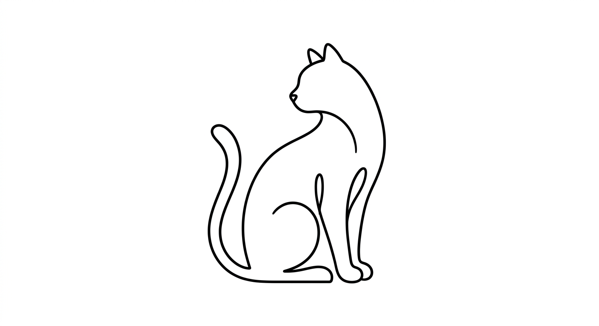
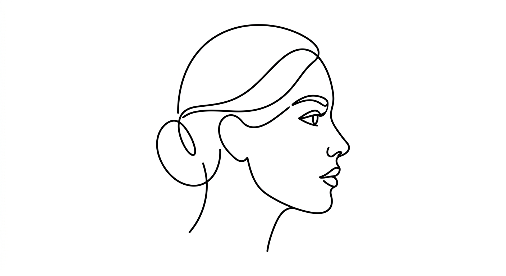
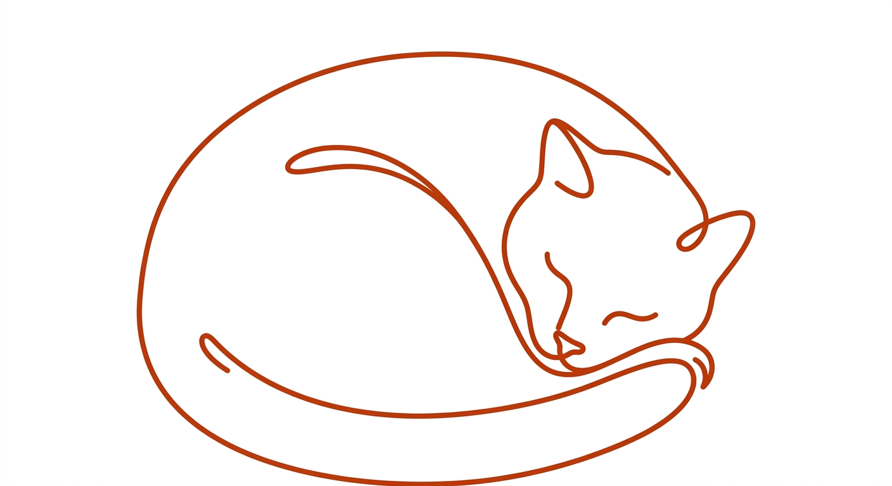
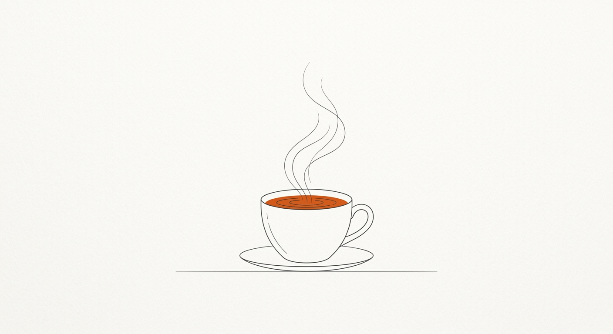
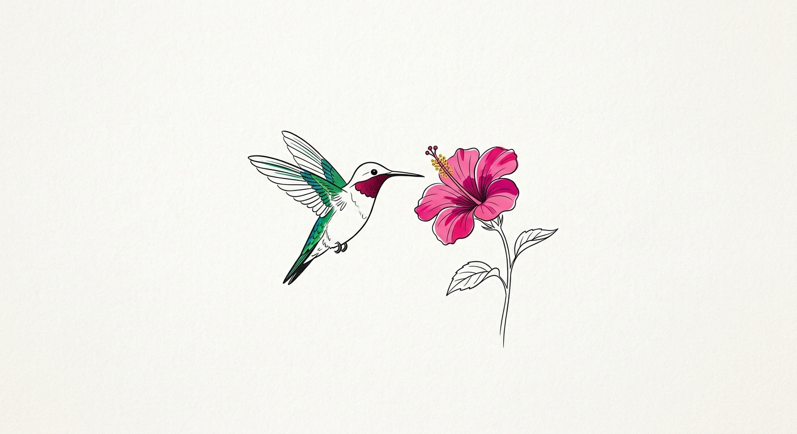
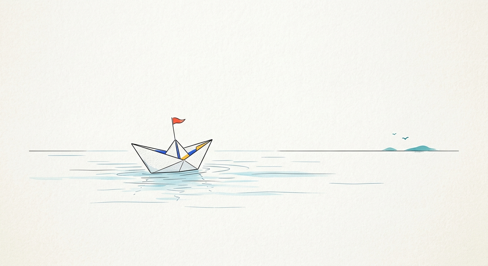

# niskill-draw

一套画图提示词技能包。你只需要说想画什么，它会听懂你的意图，从 10 套精选画风里推荐最合适的一套，把提示词填好交给你；有生图工具的话直接出图。

这些画风都是我自己日常在用、一套套挑出来的，会陆续增加。

## 怎么用

**作为技能使用（推荐）**

把整个仓库放进技能目录：

```bash
# Claude Code
git clone https://github.com/nickzhangcomes/niskill-draw ~/.claude/skills/niskill-draw

# Codex
git clone https://github.com/nickzhangcomes/niskill-draw ~/.codex/skills/niskill-draw
```

之后直接说需求就行，比如：

- “给我这篇讲复利的文章配一张封面”
- “帮茶室‘清渡’做个 logo”
- “把这张猫的照片画得丑一点，做表情包”

它会先告诉你推荐哪种画风、为什么，再给出填好的完整提示词。

**手动使用**

在下面挑一个画风，点进它的目录，复制「提示词模板」，把 `[SUBJECT]`、`【SUBJECT】` 这类槽位换成你的内容，发给任意文生图模型即可。模板保持原始语言，这是实测效果最好的写法，不建议翻译后再用。

## 画风一览

每套画风展示 3 张 demo：第 1 张是最初调试这套提示词时的原版出图，后 2 张是新样图，填法写在各自目录里，可以复现。

## 一、极简线条

干净、克制、大留白。

### [极简线条风](styles/01-minimal-lineart/)

几何规整的单色轮廓，最冷静。文生图。

<table><tr><td></td><td></td><td></td></tr></table>

### [一笔画连续线条风](styles/02-continuous-line/)

一根线不断，曲线更流动，有艺术感。文生图。

<table><tr><td></td><td></td><td></td></tr></table>

### [极简编辑风](styles/03-minimal-editorial/)

细线加少量亮色点缀，带一点杂志感。文生图。

<table><tr><td></td><td></td><td></td></tr></table>

## 二、平面色块

形状和颜色说话，几乎没有线条细节。

### [扁平色块风](styles/04-flat-vector-color/)

现代矢量感，颜色可以自由换。文生图。

<table><tr><td></td><td></td><td></td></tr></table>

### [复古版画风](styles/05-retro-woodblock/)

米白、炭黑、芥末黄三色锁定，带纸纹，书卷气。文生图。

<table><tr><td></td><td></td><td></td></tr></table>

## 三、卡通手绘

角色化，可爱、俏皮。

### [Gemma Correll 手绘风](styles/06-gemma-correll-quirky/)

带淡彩，更幽默、更“丧萌”。文生图。

<table><tr><td></td><td></td><td></td></tr></table>

### [Notion 编辑风](styles/07-notion-editorial/)

纯黑白，更克制，有产品感。文生图。

<table><tr><td></td><td></td><td></td></tr></table>

## 四、素描 / 涂鸦

笔触粗糙、手工感重，两套都是图生图。

### [铅笔极简抽象风](styles/08-pencil-minimal-abstract/)

淡铅笔，把画面剥到只剩骨架，笨拙但文艺。图生图，需要参考图。

<table><tr><td></td><td></td><td></td></tr></table>

### [胡乱涂鸦风](styles/09-messy-scribble/)

故意画丑，像用 MS Paint 画的，主打搞笑。图生图，需要参考图。

<table><tr><td></td><td></td><td></td></tr></table>

## 五、字体设计

唯一不画图的一套。

### [细线东方字形 Logo](styles/10-oriental-thin-line-logo/)

把中文品牌名本身做成细线字形标识。文生图。

<table><tr><td></td><td></td><td></td></tr></table>


## 目录结构

```text
SKILL.md                 技能说明：怎么捕捉意图、怎么推荐、怎么填槽
prompts.json             全部画风的机器可读版本
styles/<编号>-<画风>/
  README.md              说明、模板、槽位、每张 demo 的填法
  demo-1.png             原版 demo
  demo-2.png, demo-3.png 新样图
references/              新样图里图生图用到的参考图
```

## 说明

- 新样图都由 Gemini 3.1 Flash Image 生成；同一条提示词每次结果会有差异，demo 展示的是这套画风的典型效果。
- `references/` 里的参考图也是生成的，不是真实照片。
