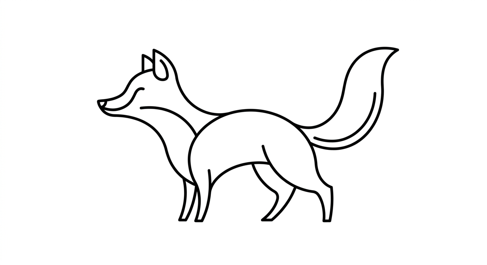
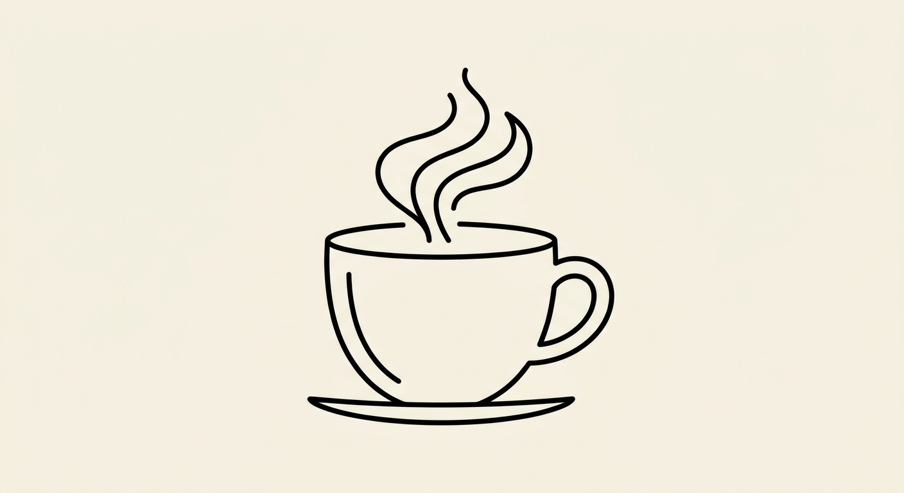
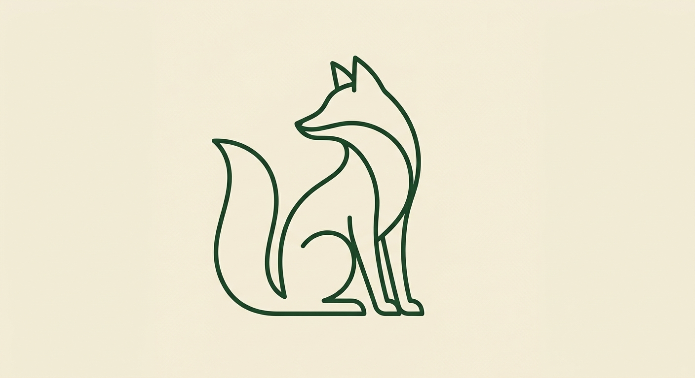

# 极简线条风

`minimal-lineart` · 极简线条 · 文生图

几何规整的单色轮廓，最冷静。

## 适合什么

适合画单一物品/动物/抽象符号的纯单色轮廓线条，没有填充、没有阴影，极几何极克制，适合做 logo、icon、贴纸、装饰元素。输入需要主体 + 线条颜色 + 背景色。不适合多元素场景、人物表情、需要质感氛围的画面。

**标签：** 物品 / 动物 / 符号 / 极简 / 线稿 / logo / icon / 轮廓 / 平面矢量 / 几何 / 留白

## 提示词模板

```text
a minimalistic line art of a [SUBJECT], illustrated in 2D flat vector style. [LINE_COLOR] outline only on a [BG_COLOR] background. No shadows, no details. Simplified shape, clean curves, and modern, abstract styling.
```

## 槽位

- `[SUBJECT]`
- `[LINE_COLOR]`
- `[BG_COLOR]`

把模板里的槽位换成你的内容即可。

## Demo

### demo-1 · 原版



最初调试这套提示词时的出图。

### demo-2



槽位填法：`SUBJECT` = coffee cup with rising steam；`LINE_COLOR` = black；`BG_COLOR` = warm off-white

### demo-3



槽位填法：`SUBJECT` = sitting fox；`LINE_COLOR` = dark green；`BG_COLOR` = pale beige
