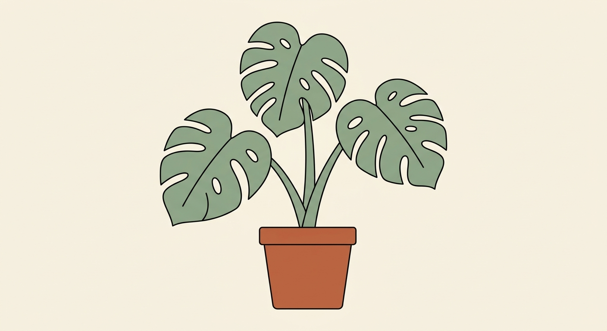
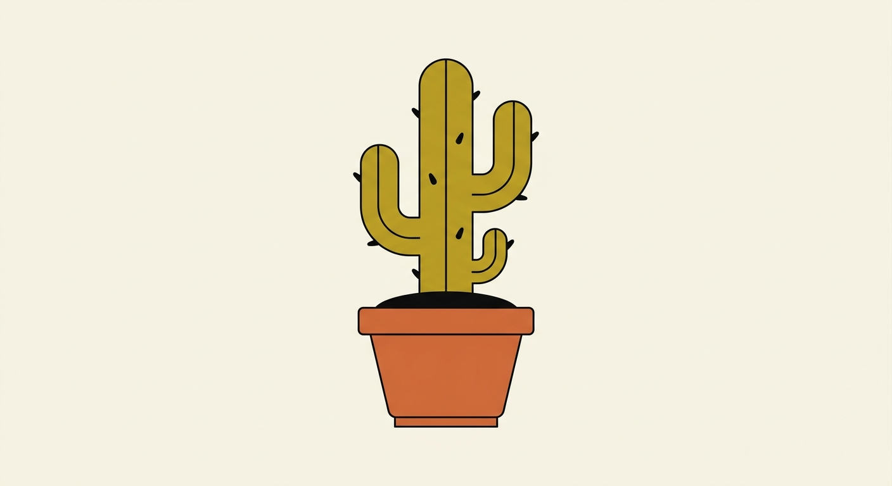
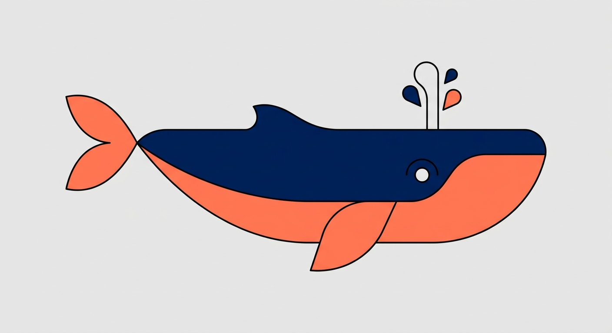

# 扁平色块风

`flat-vector-color` · 平面色块 · 文生图

现代矢量感，颜色可以自由换。

## 适合什么

适合画扁平色块 + 细线描边的单主体，色彩鲜明边界干净，适合做品牌 IP、贴纸、icon、主视觉装饰。输入需要主体 + 配色组合（如 terracotta and mustard yellow）+ 背景色。不适合写实质感、复杂场景、需要光影氛围的画面。

**标签：** 物品 / 动物 / 角色 / 扁平 / 色块 / 矢量 / 插画 / 贴纸 / 品牌 / IP / icon

## 提示词模板

```text
a minimalistic illustration of a [SUBJECT], illustrated in 2D flat vector style. Flat color shapes in [COLOR_PALETTE] with a thin black outline on a [BG_COLOR] background. No shadows, no details. Simplified shape, clean curves, and modern, abstract styling.
```

## 槽位

- `[SUBJECT]`
- `[COLOR_PALETTE]`
- `[BG_COLOR]`

把模板里的槽位换成你的内容即可。

## Demo

### demo-1 · 原版



最初调试这套提示词时的出图。

### demo-2



槽位填法：`SUBJECT` = cactus in a clay pot；`COLOR_PALETTE` = terracotta and mustard yellow；`BG_COLOR` = cream

### demo-3



槽位填法：`SUBJECT` = whale；`COLOR_PALETTE` = navy blue and coral；`BG_COLOR` = light grey
