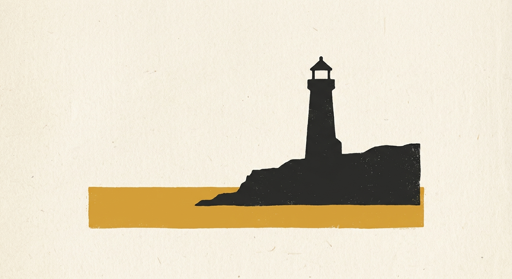
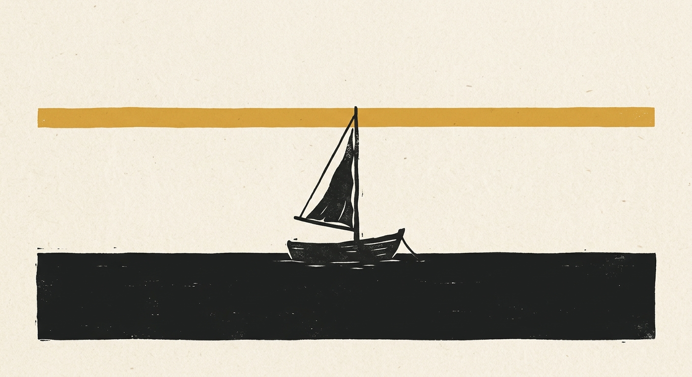

# 复古版画风

`retro-woodblock` · 平面色块 · 文生图

米白、炭黑、芥末黄三色锁定，带纸纹，书卷气。

## 适合什么

适合画单主体的复古版画风插画：米白/炭黑/芥末黄三色锁定（#F5F0E6 / #1A1A1A / #E8A33D），黑色剪影 + 黄色几何色块（圆/横带/色面三选一）的签名式对比，做旧轻微克制，气质静谧思辨、书卷气。特别适合知识类公众号配图、封面、海报——系列产出的色彩和构图语言统一。主体支持具象物、抽象概念（先转译隐喻，见 slot_guide）、版画化线条三类。不适合多色、写实、复杂多人物场景、需要文字排版的画面。

**标签：** 物品 / 动物 / 人物 / 风景 / 概念 / 隐喻 / 复古 / 版画 / 木刻 / 剪影 / 黄黑 / 芥末黄 / 海报 / 封面 / 公众号头图 / 知识 / 静谧 / 思辨 / 书卷气 / 留白 / 纸质感

## 提示词模板

```text
极简复古版画风插画，主体为【SUBJECT】，画面为单幅完整构图。画面采用大面积留白与极简构成，背景为米白色粗糙纸张质感（色调接近 #F5F0E6 的暖米白）。主体以深炭黑剪影呈现（接近 #1A1A1A），轮廓简洁、厚重、安静，细节极少，只保留关键形体特征。画面中加入一个芥末黄色块（色调接近 #E8A33D，沉稳的赭黄调，饱和度克制，不要亮橙色），形态从三种几何家族中选择其一：正圆、横向色带、大面积几何色面——具体形态和位置由画面语境决定，自然融入为最合理的视觉元素（光影、地平线、倒影、空间分割均可），不要默认画成太阳。色块与黑色主体形成强烈视觉对比。整体色彩严格控制在米白、炭黑、芥末黄三色以内，低复杂度、高识别度。构图强调静谧感、秩序感、思辨气质、书卷气，主体可偏小或居中，画面有大量空白，形成高级海报感、寓言感、复古书籍封面感、学术出版物的安静气质。质感层面：纸面颗粒、木刻版画压印、丝网印刷、轻微套印不准的手工感——但做旧程度轻微克制，是质感而非破损，不要脏污感。画面简洁克制，不要真实摄影感，不要3D，不要复杂背景，不要高光渲染，不要渐变过多，不要现代商业矢量感。无文字，无水印，无logo。
```

## 槽位

- `【SUBJECT】`：主体描述，三种用法：
  - 具象物：直接写（一只鹤站在浅水中 / 一座灯塔矗立在海岸悬崖边）。
  - 抽象概念：先转译成视觉隐喻再写入。常用词典：周期→钟摆/潮汐波浪，认知→三棱镜折出光束/灯塔，积累与复利→向上的阶梯/上扬的厚重弧带，决策→分岔的路径，机会→门/钥匙，时间→沙漏/钟摆。
  - 线条主体：必须版画化——线加粗成木刻弧带（写明走势，如「持续上扬、末端不放平」）；或让线成为黄色色块的起伏边缘；或作为黑色剪影的轮廓线（如山脊线）。纯细线撑不起画面，不要用。
  - 注意：模型倾向自动补黑色具象物压画面，要纯抽象几何构成时需在主体描述里显式写「不要出现任何具象物体」。

把模板里的槽位换成你的内容即可。

## Demo

### demo-1 · 原版



最初调试这套提示词时的出图。

### demo-2



槽位填法：`SUBJECT` = 一艘小帆船停在平静的海面上

### demo-3


槽位填法：`SUBJECT` = 时间：一只沙漏立在空旷的桌面上
