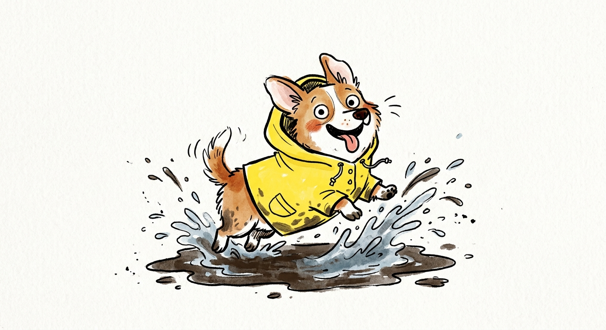
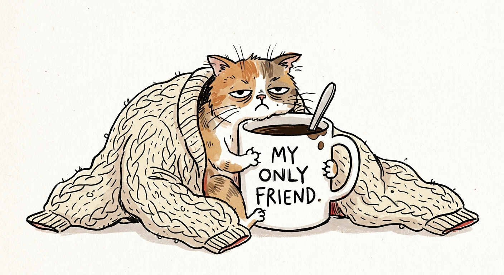
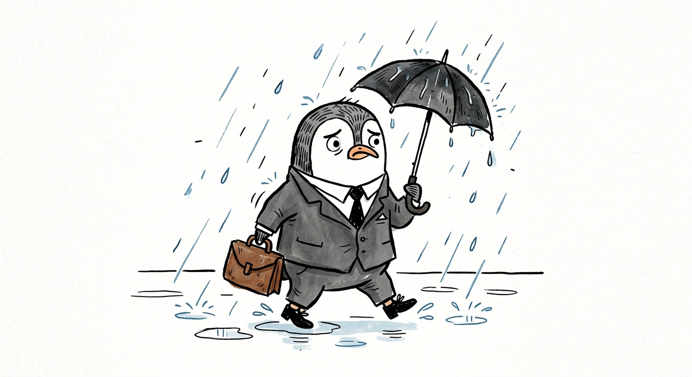

# Gemma Correll 手绘风

`gemma-correll-quirky` · 卡通手绘 · 文生图

带淡彩，更幽默、更“丧萌”。

## 适合什么

适合画人物 / 角色 / 拟人动物在做某件事，带服装、动作、表情描述，风格俏皮幽默有手绘感。输入越完整越好（角色 + 在干什么 + 什么情绪 + 穿什么），缺也能跑。不适合静物、抽象概念、严肃正式场景。

**标签：** 人物 / 角色 / 动物 / 动作 / 情绪 / 俏皮 / 幽默 / 手绘 / 卡通 / 插图 / 头像

## 提示词模板

```text
A simple illustration of a [SUBJECT] in [OUTFIT], [ACTION], with a [EXPRESSION] expression, in the style of Gemma Correll, playful hand-drawn linework, quirky character design, minimal detail, expressive posture, clean white background, charming editorial illustration feel
```

## 槽位

- `[SUBJECT]`
- `[OUTFIT]`
- `[ACTION]`
- `[EXPRESSION]`

把模板里的槽位换成你的内容即可。

## Demo

### demo-1 · 原版



最初调试这套提示词时的出图。

### demo-2



槽位填法：`SUBJECT` = sleepy cat；`OUTFIT` = an oversized knitted sweater；`ACTION` = hugging a giant mug of coffee；`EXPRESSION` = deeply unimpressed

### demo-3



槽位填法：`SUBJECT` = small penguin；`OUTFIT` = a tiny business suit；`ACTION` = carrying a briefcase through the rain；`EXPRESSION` = anxious
