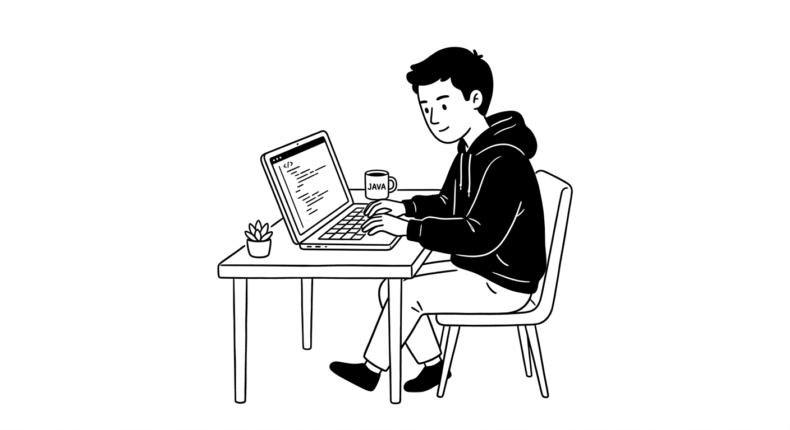
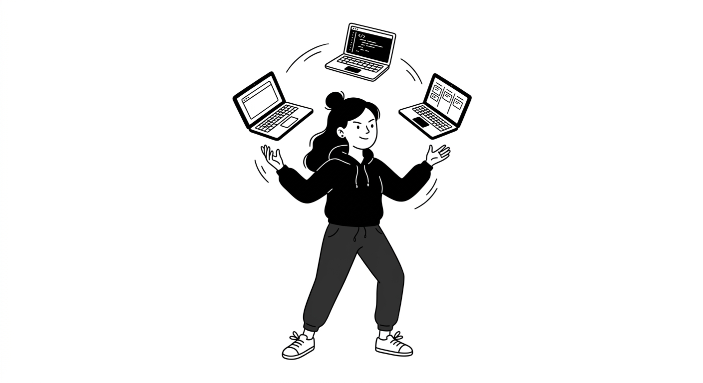
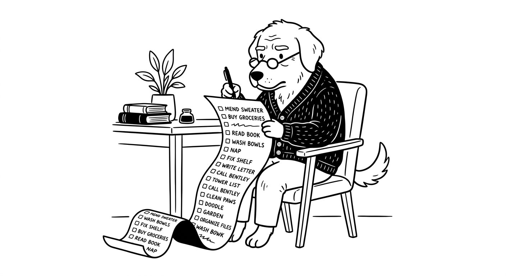

# Notion 编辑风

`notion-editorial` · 卡通手绘 · 文生图

纯黑白，更克制，有产品感。

## 适合什么

适合画角色（人/动物/拟人）穿什么、在做什么、什么表情的黑白编辑插画，柔和俏皮但克制现代，特别适合 Notion / Slack / Linear 风格的产品页、官网、文档、Marketing 配图。输入越完整越好（主体 + 服装 + 动作 + 表情），缺也能跑，模型会自动补合理默认。不适合彩色、复杂场景、写实质感、需要氛围光影的画面。

**标签：** 人物 / 角色 / 动物 / 黑白 / 线稿 / 扁平 / Notion / 编辑风 / 手绘感 / 职场 / 办公 / 产品 / 官网 / Marketing / 现代 / 留白 / 穿搭 / 表情

## 提示词模板

```text
A simple black-and-white illustration of a [SUBJECT] in [OUTFIT], [ACTION], with a [EXPRESSION] expression, in a Notion-style minimalist editorial aesthetic, clean line art, flat monochrome design, simple shapes, subtle hand-drawn feel, minimal detail, expressive posture, clean white background, neat modern layout, soft playful character style.
```

## 槽位

- `[SUBJECT]`
- `[OUTFIT]`
- `[ACTION]`
- `[EXPRESSION]`

把模板里的槽位换成你的内容即可。

## Demo

### demo-1 · 原版



最初调试这套提示词时的出图。

### demo-2



槽位填法：`SUBJECT` = young woman；`OUTFIT` = a hoodie and sneakers；`ACTION` = juggling three laptops；`EXPRESSION` = focused

### demo-3



槽位填法：`SUBJECT` = old dog；`OUTFIT` = a cardigan and round glasses；`ACTION` = reading a very long to-do list；`EXPRESSION` = thoughtful
