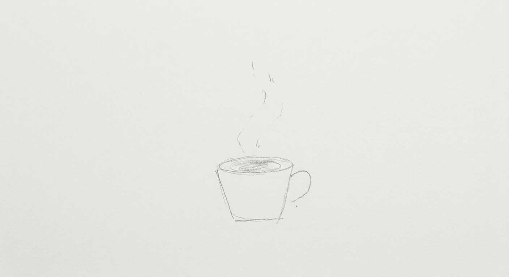
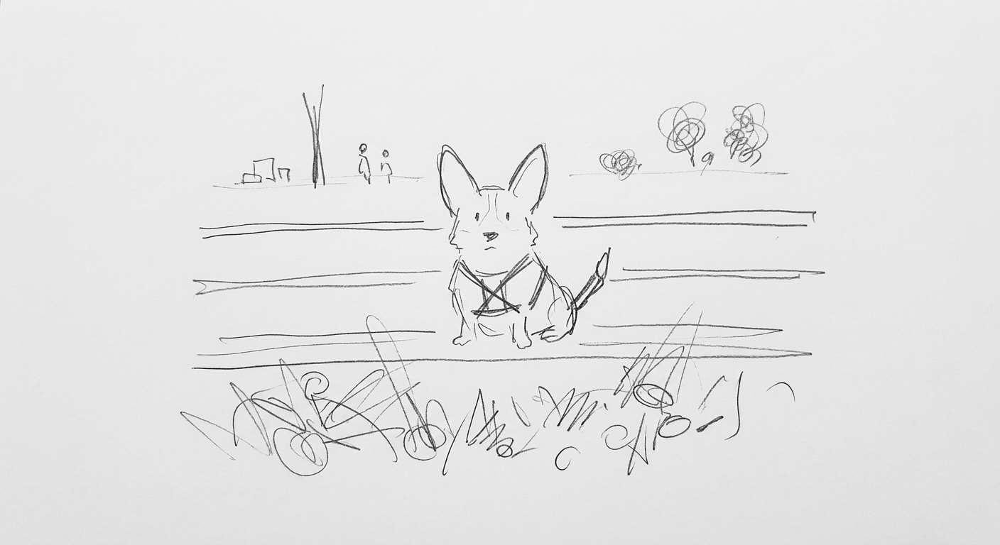
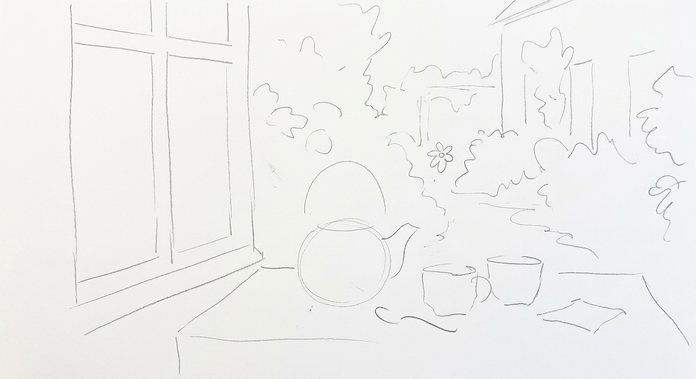

# 铅笔极简抽象风

`pencil-minimal-abstract` · 素描 / 涂鸦 · 图生图，需要参考图

淡铅笔，把画面剥到只剩骨架，笨拙但文艺。

## 适合什么

图生图专用，把参考图剥到最简，用业余感的铅笔素描重新呈现概念骨架，抹掉细节和色彩。气质笨拙但克制，文艺向，适合品牌视觉、概念海报、产品页装饰、艺术氛围配图。必须配参考图，否则跑不了。不适合纯文生图、写实质感、彩色场景，也不适合 messy-scribble 那种「故意丑/玩梗」的整活基调。

**标签：** 图生图 / 铅笔 / 素描 / 极简 / 抽象 / 笨拙 / 白纸 / 手绘 / 文艺 / 概念 / 海报 / 克制

## 提示词模板

```text
create the most minimal abstract representation of this through the medium of a terrible pencil drawing (clean, new white paper)
```

## 用法

没有槽位，把模板原样连同一张参考图发给模型。

## Demo

### demo-1 · 原版



最初调试这套提示词时的出图。当时用的参考图没有保留。

### demo-2



参考图：[`references/ref-corgi.png`](../../references/ref-corgi.png)

### demo-3



参考图：[`references/ref-teapot.png`](../../references/ref-teapot.png)
