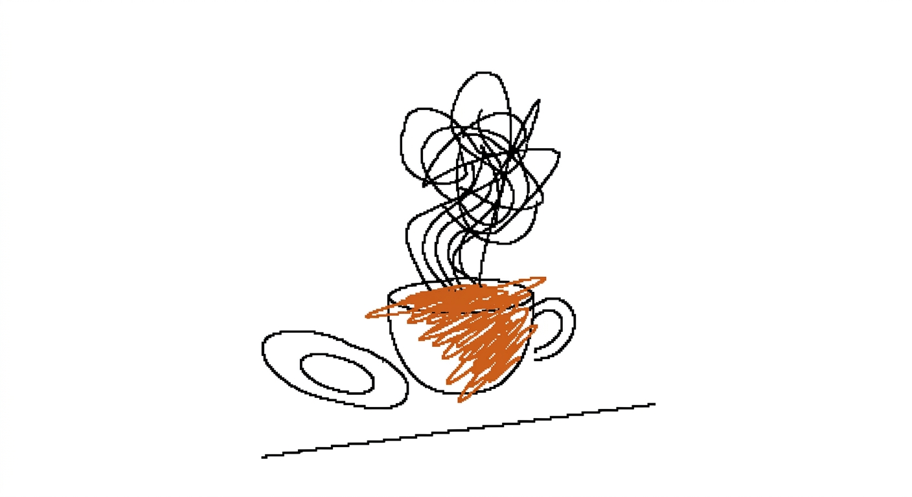
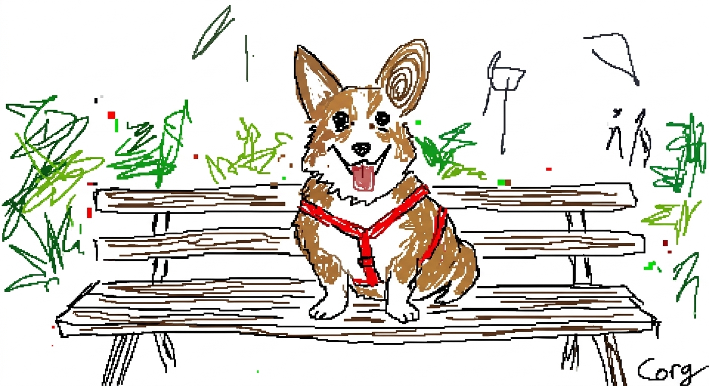
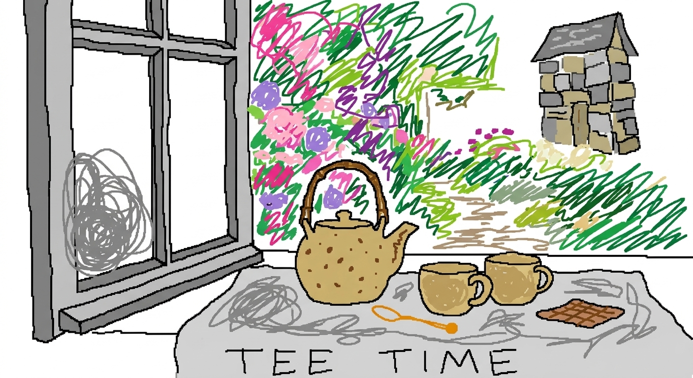

# 胡乱涂鸦风

`messy-scribble` · 素描 / 涂鸦 · 图生图，需要参考图

故意画丑，像用 MS Paint 画的，主打搞笑。

## 适合什么

图生图专用，把参考图故意重画得很丑很乱很潦草，带反讽幽默感，适合整活、玩梗、表情包。必须配参考图，否则跑不了。不适合纯文生图，也不适合追求美感或正式输出的场合。

**标签：** 重绘 / 图生图 / 反讽 / 搞笑 / 丑萌 / 涂鸦 / MS-Paint / 故意烂 / 整活

## 提示词模板

```text
Please redraw the attached image in the most inept, messy, scribble style possible, with a completely pathetic vibe. Use a white background to make it look like it was drawn with a mouse in MS Paint. Sort of make it resemble the original, but actually not really, with an awkward misalignment that kinda sorta matches but confuses you, emphasizing that low-quality pixel-by-pixel feel, and really highlighting the utterly idiotic clumsiness. Wait, hold on, whatever, do it however you want.
```

## 用法

没有槽位，把模板原样连同一张参考图发给模型。

## Demo

### demo-1 · 原版



最初调试这套提示词时的出图。当时用的参考图没有保留。

### demo-2



参考图：[`references/ref-corgi.png`](../../references/ref-corgi.png)

### demo-3



参考图：[`references/ref-teapot.png`](../../references/ref-teapot.png)
