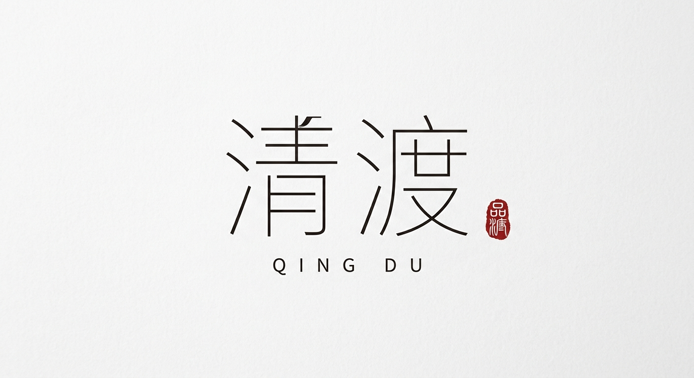
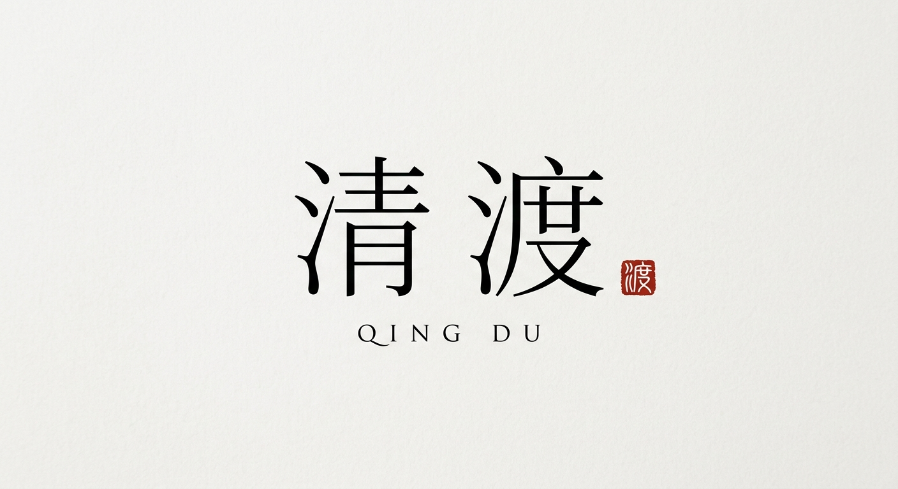
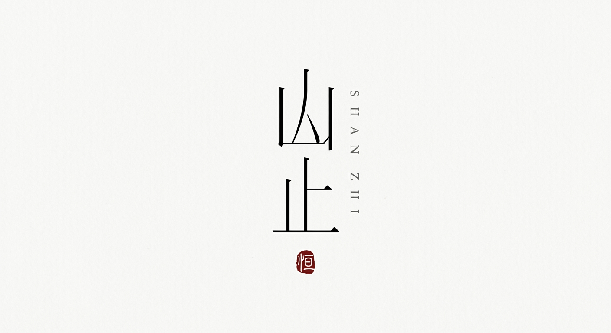

# 细线东方字形 Logo

`oriental-thin-line-logo` · 字体设计 · 文生图

把中文品牌名本身做成细线字形标识。

## 适合什么

适合为东方气质品牌（茶室/花器/陶艺/书店/香氛/器物/民宿/东方生活方式）生成中文字体型 Logo。输入需要品牌名（2-4 字中文）+ 拼音 + 排版结构描述 + 拼音位置说明。产出是「字体即 Logo」的极简标识，带朱红印章点睛。不适合英文品牌、插画型 Logo、图形符号型 Logo、多色彩 Logo。

**标签：** 品牌 / logo / 中文字体 / 东方 / 细线 / 极简 / 留白 / 印章 / 茶室 / 香氛 / 器物 / 书店 / 民宿 / 克制 / 清冷 / 现代东方 / 门头 / 包装 / 头像

## 提示词模板

```text
请生成一张《细线东方字形 Logo》。

品牌名：【NAME】
拼音辅助：【PINYIN】

整体为极简中文字体型 Logo，白色或极浅灰白背景，大量留白。画面主体不是插画，也不是图形，而是把中文品牌名「【NAME】」本身设计成视觉标识。

中文主字使用黑色细线字形，笔画修长、轻盈、克制、清冷，有现代东方感。可以对部分笔画做轻微几何化重构、拉长、断笔、错位或留白处理，但每个字必须保持清晰可读，笔画结构完整，绝对不能变成乱码或无法辨认的抽象符号。几何化是微调，不是重写——观者应该能一眼认出每个字。

【LAYOUT_INSTRUCTION】

整体重点是「字体即 Logo」：中文品牌名「【NAME】」本身就是主视觉。【PINYIN_INSTRUCTION】

加入一个小型朱红色篆刻感印章，印章内容可以是古意风格单字，也可以是抽象古印符号。印章只做点睛，不能太大，不能抢主视觉。

画面中只出现品牌名中文字、拼音字母和印章，不要出现任何其他文字、slogan、品类描述、装饰性图形或方框。

整体效果要像一枚真实品牌的现代中文字体 Logo，干净、平面化、有设计感、有系列感，适合品牌提案、门头、包装、社媒头像和视觉系统延展。
```

## 槽位

- `【NAME】`：中文品牌名，2-4 字（如：清渡、山止、半白）
- `【PINYIN】`：品牌名拼音，大写字母（如：QING DU）
- `【LAYOUT_INSTRUCTION】`：排版结构的具体描述。避免用「2×2方阵」等字面化表述，改用明确的空间描述。常用选项：
  - 横排：「两个字横向并排，字间距略大于常规，形成方正沉稳的视觉重心。不要添加任何装饰性方框、网格线或占位符号。」
  - 竖排：「两个字纵向竖排，上下排列，字间距适中。整体构图偏窄偏高，像一枚竖式印鉴。」
  - 错位穿插：「两个字横向排列，但在垂直方向上做轻微错位——第二个字比第一个字略低或略高，形成微妙的节奏感和呼吸感，而非死板对齐。」
- `【PINYIN_INSTRUCTION】`：拼音排版位置说明。常用选项：
  - 下方：「拼音 XX 放在主字下方居中，字母之间字距拉开，字号明显小于主字，保持高级、安静、克制。」
  - 侧边竖排：「拼音 XX 竖排放在主字右侧，字母纵向排列，字距拉开，字号明显小于主字，保持高级、安静、克制。」
  - 穿插：「拼音 XX 穿插在主字右上角或右侧，字距拉开，字号明显小于主字，保持高级、安静、克制。」

把模板里的槽位换成你的内容即可。

## Demo

### demo-1 · 原版



最初调试这套提示词时的出图。

### demo-2



槽位填法：`NAME` = 清渡；`PINYIN` = QING DU；`LAYOUT_INSTRUCTION` = 两个字横向并排，字间距略大于常规，形成方正沉稳的视觉重心。不要添加任何装饰性方框、网格线或占位符号。；`PINYIN_INSTRUCTION` = 拼音 QING DU 放在主字下方居中，字母之间字距拉开，字号明显小于主字，保持高级、安静、克制。

### demo-3



槽位填法：`NAME` = 山止；`PINYIN` = SHAN ZHI；`LAYOUT_INSTRUCTION` = 两个字纵向竖排，上下排列，字间距适中。整体构图偏窄偏高，像一枚竖式印鉴。；`PINYIN_INSTRUCTION` = 拼音 SHAN ZHI 竖排放在主字右侧，字母纵向排列，字距拉开，字号明显小于主字，保持高级、安静、克制。
